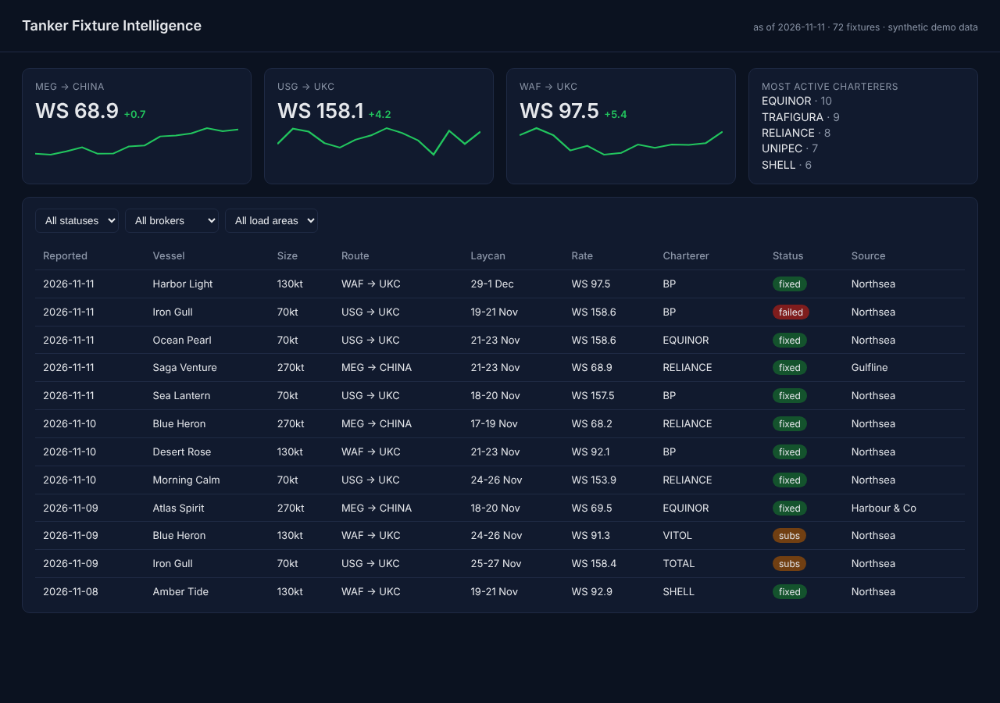
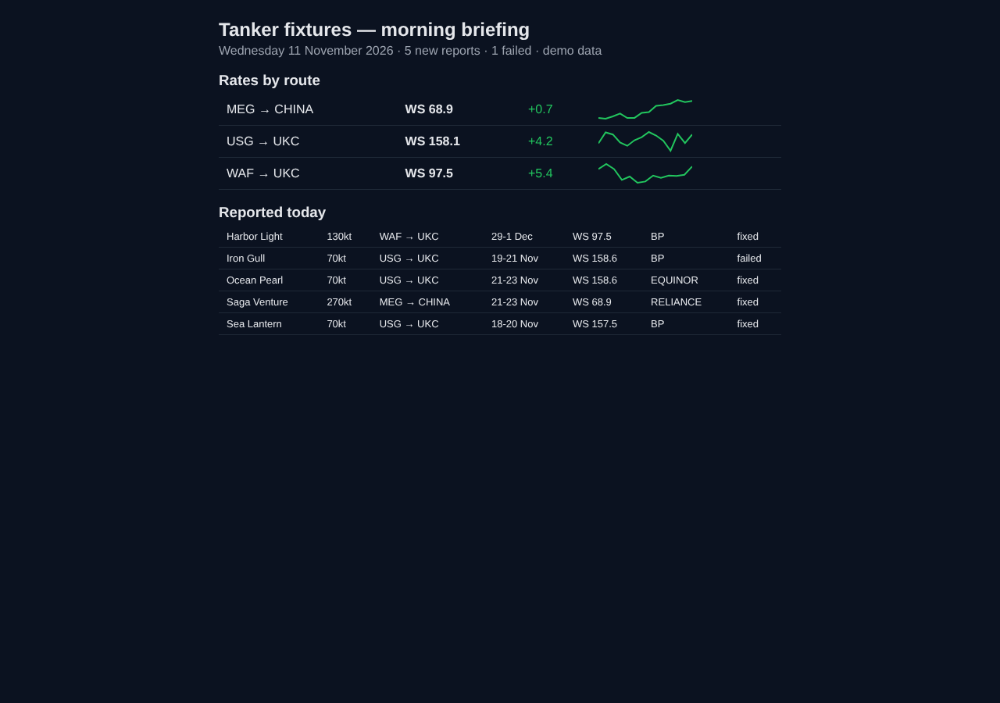

# fixture-intel — tanker fixture intelligence from broker emails

> **Clean-room rebuild.** I built the original system during my 2026 internship on the
> oil trading desk at Enervest / 1ENERGIN DMCC (Dubai), where it ran in production for
> the desk. That code and its data belong to the company, so this repo is a
> re-implementation of the same architecture on **fully synthetic data**: invented
> brokers (`*.example` domains), vessels, charterers and rates.

Shipbrokers email "fixture reports" every morning: which tanker was chartered, by
whom, on which route, at what rate. Each broker uses a different format, and the
desk was reading them by hand. This pipeline turns that inbox into one clean,
deduplicated dataset, a live dashboard and a morning briefing email.



## Pipeline

```
Broker inbox ──► ingest ──► broker-specific parser ──► dedupe ──► SQLite ──► Flask API ──► dashboard
(Graph API)      (.eml)     (chosen by sender domain)  (latest       │
                                                        report wins)  └──► morning briefing email
                                                                          (inline SVG sparklines)
```

| Step | File | Notes |
|---|---|---|
| Ingest | `fixtures/graph.py`, `fixtures/ingest.py` | Production read the shared mailbox with **Microsoft Graph** (MSAL app-only auth, paged `$filter` on `receivedDateTime`). The demo reads `.eml` files through the same `ingest_messages` function. |
| Parse | `fixtures/parsers.py` | One small parser per broker: slash-separated lines, a pipe table mapped **by header name** (column order drifts), and free prose. Unreadable lines are returned as `unparsed` for review, never silently dropped. |
| Dedupe | `fixtures/ingest.py` | The same fixture is reported by several brokers and moves from *on subs* to *fixed/failed*; key = vessel + laycan + load area, latest report wins. |
| Store | `fixtures/db.py` | SQLite upsert with the same "latest wins" rule, so re-runs are idempotent. |
| Serve | `app.py`, `static/index.html` | Flask JSON API + dependency-free dark dashboard with route cards, sparklines and filters. |
| Brief | `fixtures/briefing.py` | HTML email with **inline SVG** sparklines and inline styles, because mail clients drop JS and external images. |



## Run it

```bash
pip install -r requirements.txt
python scripts/make_samples.py   # 14 days of synthetic emails from 3 brokers
python -m pytest -q              # 8 tests
python run_pipeline.py           # ingest -> fixtures.db -> out/briefing.html
python app.py                    # dashboard on http://localhost:8080
```

Demo run: 43 emails → 166 parsed rows → 72 unique fixtures after deduplication,
0 unparsed lines, 1 unknown sender skipped.

## How the production version differed

- Ran on a company Windows VM, scheduled with **Windows Task Scheduler**; the dashboard
  was served to the desk on the internal network, and the briefing went to the trading
  team every morning.
- Started as an Outlook automation (pywin32/COM) with a single regex parser; moving to
  the Graph API and per-broker parsers is what made it reliable enough for daily use.
- Handover included documentation for the next intern and IT (VM, network access,
  scheduling).

A second internship project, a **Python/Streamlit PnL dashboard** deployed on the
desk's trading server, is not reproduced here.
